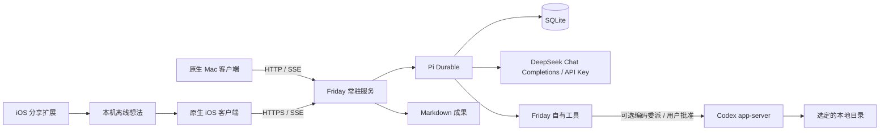

# Friday 的执行边界

Friday 保存长期产品状态，客户端负责交互，CLI 工具执行具体工作。关窗、网络断开和执行进程生命周期互不绑定。0.1 的主机和执行器部署在同一台 Mac；远程独立执行节点尚未实现。

## Pi Durable 的职责

`friday.respond` 管理 Friday 请求的排队和成果；其独立 conversation 使用 Pi Durable 内置 `pi.generation` / `pi.tool` 执行模型与工具循环。`friday.execute` 管理独立的本地 Agent 任务，使用 checkpoint、memo、等待依赖和终止状态。任务创建和应用状态更新在同一 Durable commit 中保存。不同本地任务可以并行，同一任务的轮次保持顺序；Friday 主会话保留独立的请求队列。旧版本已经保存的全局依赖仍然有效，不重新排序或重放。

`friday.task_queue` 管理本地任务的后续消息，使用 Durable 的依赖等待与 checkpoint，不另建运行引擎。排队输入的原请求 ID、分发 ID、执行任务 ID 和状态一并保存；编辑、排序、取消和提升为 Steer 都验证当前状态。排队消息开始时才加入时间线，模型和推理强度按该消息保存。停止以及服务启动/关闭都会挂起剩余输入，由用户明确继续；窗口断开本身不停止服务。未知的 Steer 回执保留为 uncertain，不转换成新的外部轮次。

Pi Durable 不是 CLI 外部副作用的事务管理器。Friday 在启动外部 turn 前保存 external-started 标记与 thread ID；重启后不确定的 turn 需要用户继续。Pi Durable 的存储由单进程持有，另一个 SQLite writer transaction 用作会随进程退出而释放的占用锁。

Friday 现在自己运行模型决策循环。每个会话在提交前原子保存 conversation ID，输入用 request ID 去重；模型消息和工具结果进入同一 SQLite。动态 prompt section 读取当前显式记忆、项目背景和 Skill。普通请求不依赖 Codex 安装。

新对话沿用直接输入的交互，内部采用 `auto` 模式。`friday_request_workspace` 把必要的目录选择交给界面，持久化为 `needs_project` 后释放执行队列；选择目录后复用原 Friday conversation。`save_idea` 仅用于明确的记录请求，不自动交办。旧任务继续兼容。

自有工具包括 workspace、friday_request_workspace、save_idea、remember、list_files、read_file、save_note、write_file、ask_user；delegate_codex 仅在选定项目的编码请求获批后执行，research 模式保持只读。项目路径经 realpath 校验，拒绝越界和部分明确的凭据文件；这是一组受限文件工具，不是通用 OS 沙箱。写项目文件展示全文并等待授权，无通用 shell 工具。

读取、基于 tool-call ID 去重的内部写入和提问可安全恢复；文件写入、笔记文件和外部调用标记 unsafe，中断后由 Pi 返回 interrupted，不自动重放。用户问题和答案在 workspace 中持久化；中断的其他待决授权失效。

模型接入使用 pi-ai 的 DeepSeek provider，直接请求官方 Chat Completions API，默认 `deepseek-flash`。主机 owner 在 Providers 的 Friday 页面配置 API Key；先发一次非思考模式的简短测试请求，成功后以 0600 权限串行、原子保存，失败保留旧密钥。配对设备只能查看连接状态；凭据不进入快照。正常会话支持流式回复、思考与工具调用；后续用户消息保留原 conversation，并切到当前配置的模型。旧 OpenAI 凭据保留但不再使用，OAuth 入口已移除。

## Codex 适配器

通过 CLI 的 `app-server --listen stdio://` 使用 JSONL 双向 RPC。Friday 创建自己的原生 Codex thread，保存 ID 后启动 turn；继续任务使用 thread/resume，补充要求使用 turn/steer，停止使用 turn/interrupt 并结束连接。

未选择目录的新对话使用 read-only 和 never，防止通过授权请求绕过选目录；选择目录后使用 workspace-write 与 on-request、reviewer 为用户，只有用户提出修改要求时才应修改文件。旧调研任务仍只读。工具请求只有在能显示具体范围时才接入；未知权限请求保守拒绝。CLI 原生的文件系统与网络隔离仍是实际执行边界，提示词只补充行为约定。

第一版管理的是 Friday 创建的任务。没有宣称能接管 Codex 桌面端、Claude Code 或其他工具已经打开的任意会话。

## 三层记忆

| 层 | 内容 | 写入与读取 |
| --- | --- | --- |
| Session Memory | Friday conversation 的模型消息、工具结果；可选 Codex 的 thread ID | Pi Durable 持久化并复用 Friday 会话；Codex 只保存其受委派部分 |
| SQLite Long-term Memory | 用户明确保存的偏好、项目背景 | UI 增改删，remember 工具新增；模型循环读取当前快照 |
| Skill Memory | `skills/*/SKILL.md` 中可复用工作流程 | 维护文件；Friday 动态读取，旧执行器固化到任务输入 |

没有从全屏监控或输入法中自动抽取记忆。目前系统上下文注入用户保存的显式记忆和关联项目背景；workspace 工具可按模型需要读取有上限的想法、项目和任务概况。未来应增加按相关性选择、来源及过期管理。

## 同步与授权

任务集成终端使用原生 SwiftTerm 与主机 node-pty。`friday.terminal` 通过 Pi Durable 保存打开／重启／关闭意图，启动前先保存 task、terminal ID、generation 与 boot ID；同一 boot 的已知句柄可核对，跨进程的未确认操作不会自动重建 Shell。终端按任务的真实 cwd 启动登录 Shell，客户端不能指定任意执行目录。关闭面板、切换任务、客户端断线只解除订阅，主机继续保有 PTY；明确关闭或删除任务才终止当前持有的进程及子进程组，不通过旧 PID 接管或杀死未知进程。服务正常停止也会关闭本次持有的 PTY，保留中断状态与历史，等待明确重启。

原始 VT 字节独立写入私有 `terminals.sqlite`（0600），每个终端保留最近 8 MiB／5000 个换行，避免高频终端输出放大整个 workspace document。单独的认证 SSE 使用 generation／sequence 重放、慢客户端队列上限和失效凭据检查；客户端用原生 VT 解析器展示，历史重放期间不回送控制查询或输入。键盘输入通过稳定请求 ID、内容摘要和发送前回执去重，未保存明文按键；响应丢失时只查询回执，不自动重发命令。各终端的进程状态独立于 Agent Working，Git 与开发服务器可同时工作，服务更新会等待忙碌终端结束。终端选区可捕获为任务输入框中的上下文标签，Provider 专属环境仍待补齐。

文件、目录、代码行和终端选区快照保存在私有 `task-contexts.sqlite`（0600），每次捕获使用稳定 ID、内容摘要和请求指纹去重。状态快照、草稿、消息、排队和回退只携带引用元数据；实际发送时读取原快照，以标为资料的 JSON 封装传入 Agent，不重新读取已变化的工作区。文件预览使用内容版本核对，真实路径限制及私有数据排除与工作区边界保持一致；终端捕获验证所属任务和 generation。引用不增加执行引擎，任务派发继续由既有 Pi Durable 流程管理。

客户端使用原生富文本附件展示行内引用，保留文字选择、撤销、复制与输入法；未插入引用随所属任务草稿保存，并核对服务身份、插入 ID 和位置，防止切换任务后误插。引用预览缓存按服务和凭据隔离，正文保存在私有缓存文件，不进入偏好或 Git。源目录移除后仍可读取已保存引用。跨任务引用导入、Diff/消息选区引用和通用文件附件尚未实现。

HTTP 负责命令，SSE 发送带 revision 的完整状态快照。重连先拉最新状态，无需假设客户端收到每个 token。客户端离线只缓存想法，稳定的 idea ID 防止重复；任务命令通过 request ID 去重。手机后台不维持永久在线承诺。

本机 owner token 存在私有文件，远端设备各自拥有可撤销 token，服务只保存其哈希。配对不携带旧主机凭据。外部访问要求 TLS；Tailscale 可提供设备间私网入口，但不替代 Friday 的授权。

Connections 的个人接入方案使用 Tailscale Serve 提供私网 HTTPS，手机需要常驻代理时由 Shadowrocket 内置 Tailscale 模块处理同一 tailnet 的连接。MagicDNS 负责设备名称解析，DERP 在无法直接连接时提供加密中继，Friday 继续独立检查设备凭据。配置步骤、接口和验收范围见 [Connections 模块指南](connections.md)。

## 第一版规模

一个用户、一个服务，一个有上限的 workspace document。当前最多 300 个任务（含归档）、100 条显式记忆，Workspace 内保留每任务最近 600 条执行事件；移出的事件在同一个 Pi Durable commit 中写入独立文档分页，不再直接丢弃。本地 Agent 的公开正文、摘要和完成的可读工具结果完整保存，原生客户端按轮次及紧凑条目读取；Friday 主对话的展示仍限制 80k 字符，完整模型会话由 Pi Durable 保存，本地 Agent 会话也保留其原生存储。任务菜单提供归档、恢复与删除；归档仍占记录额度，删除 Friday 记录不删除项目文件或原生 Agent 会话。早期已截断记录的原生恢复与进一步扩容仍需实现。

后续增加多 executor 时，保持 run、answer、steer 的边界，同时显式描述每个工具的继续、取消、授权、事件和成果能力；不要假定所有 CLI 都支持同样的协议。

## 任务会话与 Providers 配置

默认提交的 agent 为 friday，始终创建或复用 Pi Durable conversation。只有显式选择 codex 或 Friday 经批准委派时才进入外部执行任务；续聊不能切换会话所属 Agent。委派任务保存 parentId，主会话与子任务的 transcript、thread ID 和审批分别持久化。

/api/model 只管理 Friday 的 pi-ai provider。/api/agents/codex 独立检测 initialize、account/read 与分页 model/list；Providers 将 Friday 的 API 配置与本地 Agent 的运行配置放在同一设置入口，本地 Agent 配置不覆盖 Friday 模型配置。Codex 配置的环境变量值在接口中隐藏，配对设备不返回账号邮箱与运行配置。Codex 自己管理登录凭据。

每个 Codex 任务持久化 model、reasoningEffort、thread ID 与账号目录；外部 turn 开始前先保存这些状态。运行期间可为后续排队消息选择模型或推理强度，不改变当前外部 turn。输入可 Steer、Queue 或停止，非就绪时只能保留到队列；`canSteer` 来自当前适配器状态，重启时失效。当前采用 workspace-write / on-request，不提供 Full access 开关。实现参考本机 T3 Code 的 ThreadTurnStartCommand、modelSelection 与同 thread 续聊流程，界面使用原生 SwiftUI。

## 任务侧栏顺序

`pinOrderKey` 与 `activeOrderKey` 保存在原任务的 Durable 元数据中，使用 T3 的字母分数索引和分组排序规则；窗口不依赖流式输出更新时间重排行。跨 Workspace 保留隐藏排序键，必要时只重写当前可见分组。排序事务检查请求的范围、来源分组和目标 ID／键快照，过期变更返回 409；私有请求回执保证重试不会覆盖后来的排序。置顶、活跃与已结束间的移动同步清理生命周期字段；恢复已结束任务清理旧活跃键并记录继续锚点。紧凑摘要携带排序键与已结束排序时间，原生行、快捷键和服务保持一致；只读能力声明使新客户端连接旧主机时不提供无效入口。行拖拽采用原生专用数据类型及窗口 token，账号／服务／范围变化使旧载荷失效，标题编辑保留原生输入。

Working（Beta）为本地客户端偏好，默认关闭。`sidebarActivity` 仅传输真实执行是否仍在处理及用户发送／运行请求／完成时间，待授权内容留在独立正文协议中；排队请求映射回原发送时间，回退消息不进入活动锚点。客户端在数据层观察处理转为用户可操作状态的时间，首次读取不补造返回，在相同服务的页面与 Workspace 切换间保留，账号／服务变化及关闭开关时重置。Working 按用户最后发送排序，Inbox 按请求、完成、恢复和观察到的返回排序；时间模式的跨组请求不改写手动键，关闭后恢复原有顺序。Working 后台命令、监控及子 Agent 仍需真实协议接入，当前不从工具文本猜测这些状态。

## 自动结束跟进

`taskSettlementSettings` 将无活动天数保存到 Durable 主机默认及 Workspace 覆盖，默认 3、空值关闭，独立版本用于跨设备比较保存。服务启动追赶及一分钟定时器核对已保存状态，终止执行与相关设置／元数据变化可立即核对；定时器只负责可重建的通知，不承担外部执行。候选判断和写入使用同一事务，基于真实用户／运行活动及 Snooze 唤醒时间，并保护待输入、执行、队列、未确认发送和原生会话操作。空核对不更新修订，停机等待在途写入。

手动恢复保存明确的 active 覆盖，直到下一次真实执行；自动结束保存回溯到最后活动的 settled 时间并清除排序键。客户端以服务托管声明区分新旧主机，新主机的分组直接反映已持久化状态，不用本机固定三天推测。已知开放 PR 会阻止无活动结束；完整 PR 关闭／合并策略、结束后的终端／Worktree 清理及脚本仍是后续能力，本阶段不执行这些外部副作用。

## 任务标题的后台生成

任务标题由独立的 `friday.task_title` Pi Durable 工作生成。首次任务输入和显式重新生成分别保存请求 token，原生身份保存在私有 `titleRequests` 回执；侧栏只读取能力和进行中状态，不传递模型会话、输入正文或内部回执。手动改名及更新的 token 使旧结果失效，后台工作不占用任务的正文会话或改变活动时间。初始命名只重试已确认结束的失败；进程恢复复用已保存文字，未知外部结果不重放。Codex／Claude 的结构化文字生成使用独立工具禁用边界，关闭时中断，删除时等待其结束；Provider 配置和更新维护屏障包含这类工作。策略设置仍见任务对齐清单。

标题主题可从输入中的 GitHub／GitLab 公共主机 Issue／PR／MR 地址补全。读取只用固定主机和构造的只读 API 路径，最多并发两个，各三秒、主题 300／1,200 个字符预算；失败降级为不可用，不根据本地 Git 历史猜主题。有界摘要在当前尝试的私有 Durable memo 中保存后才启动模型，不进入用户正文或记忆；取消和超时结束对应 CLI 进程组。恢复时复用已有摘要，外部模型的未知结果仍不重放。普通 Git 命令和这类读取共用连续 UTF-8 解码和有界输出收集，但标题读取没有额外终止宽限；完整 Source Control 的共享配额和认证缓存仍待对齐。

文字模型偏好存入同一个 Durable Workspace 文档，`textGenerationModelSelection`、可空的 `sourceControlWriterModelSelection` 和 `sourceControlWritingStyle` 支持主机默认和 Workspace 单键覆盖；版本比较阻止跨设备覆盖。普通任务模型与文字模型互相独立，标题请求及 Git 操作保存冻结选择。停用 Provider 与不可用的 Source Control 选择按对应继承规则回退；没有可用的标题模型不能使主体任务提交失败。公开快照只公布偏好版本和不含凭据的生成设置；原生设置页按账号／服务／范围／请求 token 接收回执，自动保存不把旧弹层操作带到新范围。

Source Control 写作支持仓库惯例、Conventional Commits、自定义说明和独立 PR 模板开关。仓库惯例读取最近 20 条非合并提交标题、当前目录内不超过 20 KB 的 AGENTS.md，以及 Claude 写作模型对应的 CLAUDE.md；说明只能作为写作参考。GitHub PR 模板从目标分支的已提交 Git blob 中选择，不读取工作区文件或符号链接；固定位置按优先级查找，目录中有多个非空 Markdown 模板时不擅自选择。树清单最多 100 KB，模板保留 8 KB UTF-8 前缀，截断不破坏字符；无法读取时退回默认 Summary／Testing 结构。生成 PR 时传入提交、统计和有界实际补丁，过滤 Friday 私有数据目录。Git 操作开始前保存写作风格和模型，中途修改设置只影响后续操作；外部生成身份、阶段回执和未知结果不重放的约束保持一致。

## Git 操作与会话分离

`friday.git_operation` 是独立的 Pi Durable 任务。阶段开始和结果回执分别保存；未知外部结果不自动重试。操作记录与生成说明的原生 session/turn ID 存入私有 Workspace 文档，不作为用户聊天轮次，也不改变任务的处理用时和会话状态。

提交确认保存内容指纹与所选路径，原生 Git 负责 hooks 和提交；未选文件的暂存与工作改动继续保留。发布前检查分支、远端和上游状态，推送不使用 force，拉取只允许快进，PR 先查询现有结果。真实路径及重叠目录构成互斥范围，Agent 与分支/队列操作不能穿过正在执行的 Git 操作。后台服务关闭或操作中断会结束其进程组；状态未知时保留记录供用户核对。

Diff 和 Git 选择显式排除 Friday 的私有数据目录，包括数据目录位于项目内部的开发配置。托管 Worktree 通过持久计划、真实路径、Git 主仓库及 worktree 管理记录验证后，只将自己的项目源文件视作工作区。说明生成只接收所选补丁或提交范围，使用独立只读会话及禁用的工具边界；凭据、原任务对话、记忆与运行数据库不进入 Git 内容。

## 工作区准备失败与重试

工作区准备和 Agent 执行分开记录。准备失败时保留原轮次、用户消息、原始 Durable 输入和附件；显式重试由新的 Pi Durable 执行任务调度，逻辑轮次 ID 不变。重试回执按任务和轮次去重，旧执行的终态确认后才开始新尝试；模型已经开始后的失败不能借此入口重放。

重试先核对 Git 状态。已完成的 Worktree 必须匹配原仓库、分支和固定提交；仅分支已创建时可以重用同一提交的分支。目录已有文件、路径替换或登记冲突时保留文件并报告原因。新尝试仍在 Git 修改前保存 `preparing`，服务恢复只核对已有结果，不自动重复未知操作。

准备失败暂停的排队消息归属于失败轮次，重试成功后继续原顺序；手动暂停、重连暂停或较晚轮次持有的队列保持暂停。原生界面在原用户消息下显示准备错误和重试入口，重试受理后移除旧错误；准备阶段不计入 Agent 的 Working 时钟。

逻辑轮次和消息顺序与实际 Agent 执行顺序分开保存。起始检查点完成后、启动 Agent 前，记录单调的执行序号和当前完整消息位置；早期准备失败的轮次后来重试时，输入不移动，实际执行排在已完成的后续轮次之后。旧记录从保存的回复位置和检查点时间推导顺序，原生适配器仍验证实际历史。分叉按所选回复的实际前缀复制，回退按实际执行后缀移除，并使用最早被移除执行的起始文件检查点。

## 每轮文件检查点

每个本地轮次持久保存其用户消息、Durable ID、原生 session/turn ID 和执行前后检查点。检查点在现有 `friday.execute` 的执行阶段内捕获，不增加自制执行引擎。Agent 启动标记位于工作区准备和起始快照之后；Agent 完成后先保存结果回执，再捕获结束文件状态。重启不重放未确认的外部执行，已确认的结果可直接恢复；没有已保存结束快照时不把停机后的文件变化补算进去。

快照使用独立 Git 索引、Friday 私有裸对象库和静态提交说明，用户的 HEAD、索引和引用保持原样。仅保存当前任务目录的源文件树，并物化全部可达对象，源仓库的 GC 不影响已保存 Diff。HEAD 发生变化时，整轮净改动参照 T3 的 authored-path 规则，结合两端脏改动、本轮提交与 remerge 差异，排除干净引入的既有上游内容。原生时间线在最终回复后提供净改动卡；旧轮次、未知结果或不完整检查点保留逐工具补丁及明确的不可用说明。

## 会话回退与文件恢复

`friday.rewind` 是独立的 Pi Durable 任务，持久保存消息位置、保留前缀、原生回执、目标检查点和待返回输入框的请求。Codex 使用 paginated history 与 `thread/revert`，在读取全部页并核对任务已知前缀和尾部后才允许移除历史；未知结果通过只读检查原历史或已回退前缀确认。Claude 保存顶层 SDK 链消息游标，包含工具结果，以 `resumeSessionAt` 续接保留的历史；回到开头时分配新会话。缺少映射时要求明确选择新的 Agent 会话，保留原记录，不冒充已修改原生历史。

原生结果确认后立即投影可见消息、事件和轮次，旧内容及不确定输入回执保留审计标记。未完成的回退阻止同范围任务、Git、分支和队列改变绑定。文件恢复要求独占托管 Worktree，包含归档及历史路径检查；源文件回到所选请求之前，当前分支与 HEAD 保持，恢复内容呈现为未暂存改动。已清理的目录只在原 Git 管理记录仍能验证时重新关联，不猜测替代分支。文件恢复若中断或文件在停机期间改变，用户先核对当前 Diff，再明确重试或保留当前文件；不会盲目重复未确认的文件写入。

较早输入的重试执行位于所选回退位置之后时，原输入保留，后续执行与对应回复、活动和改动卡从可见历史中排除；不会自动重播保留输入。排队回执按实际 Durable 尝试退役，Claude 的续接游标按实际上一执行选择。回退操作冻结被移除的执行集合，并保存历史指纹版本，旧版本丢失回执的操作继续按原格式核对。

发起端按服务和任务保存回退请求 ID、原草稿和附件。收到已确认的消息投影后才将原请求返回输入框，并使用新的发送 ID；断线重连或切换任务的旧异步回执不会覆盖另一条会话的草稿。历史分页读取已接入，早期已截断记录的原生恢复仍需后续实现。

## 历史分页

任务事件使用 Pi Durable 的 Session 文档族保存：分页正文和事件位置索引与 Workspace 的尾部裁剪在同一事务提交，分页每次最多读取 128 条；没有第二个事件数据库或自制恢复流程。迟到的同 ID 更新回到原位置，首次出现顺序保持稳定。分叉复制其历史前缀的分页，删除源任务后不依赖源对话；回退时按已提交的轮次和投影回执呈现失效标记，不能把旧分页重新加入当前可见历史。

历史游标绑定任务和投影 epoch；新输出追加不移动已发出的旧游标，回退或分叉投影变化则使旧游标失效。原生窗口保留已展开记录，并以更新的序列覆盖同 ID 的旧页。加载旧页保留原生滚动目标，工作日志使用稳定的轮次/前一消息标识。

原生客户端通过 `history=turns` 选择按轮次传输窗口：最近 10 个用户轮次、较早页 20 轮、定位指定条目时最多 40 轮。工具活动不拆分普通会话轮次，因此同一轮超过 Workspace 的 600 条事件尾部时仍读取其已保存的完整日志。消息和轮次的内部记录保持完整，较早消息按不可变的位置分页；Steer 补充要求不占用新的用户轮次。旧客户端继续使用原有快照和 128 条事件页。

事件页的轻量轮次范围索引与正文一起提交，按轮次读取只访问相关归档页；升级时可由已存文档重建索引。公开事件与消息回执的变动摘要用于补齐已展开窗口中的迟到更新；摘要缺失时只读核对已载入的冷记录，不重复执行 Agent。分页、批量读取和实时状态使用序列、任务、账号及投影 epoch 隔离异步结果；控制用轮次元数据不会在尚未载入的旧对话位置生成改动卡。

没有用户轮次起点的前缀按 75 项／1 MiB 的 UTF-8 JSON 后备预算读取，定位条目时最多 150 项；单项超限仍完整返回并推进游标，额外控制数据或完整普通轮次导致超限时明确标记。混合消息／事件游标使用稳定条目身份，数字位置变化不影响已发出的锚点；原生窗口独立保存可见消息身份和控制消息，保留已经展开的记录。后续出现用户轮次时继续遵循完整轮次策略；通知作为 run 首次输入时计入 150 个 raw starts 上限，Steer 和同 run 后续通知不重复计数。

前缀时间和通知标记索引与事件在同一 Durable 事务提交，旧索引可由归档重建。无时间戳的旧回答放在下一用户请求之前，缺少消息列表的旧任务保留 prompt／result 显示。新原生客户端使用 `itemHistory=1` 显式选择混合条目坐标，旧客户端和未升级主机继续使用原协议。混合历史当前仍先读取本任务归档再选有界传输窗口；存储层范围查询、Provider 原生历史修复和细粒度事件重放继续对齐。升级前记录的完整性单独标为 legacy，不能由分页机制补造已经丢失的内容。

## 任务摘要与正文订阅

原生客户端通过 `/api/overview` 和对应 SSE 读取根数据及任务摘要。摘要保留身份、生命周期、活动时钟和必要控制状态，明确标记正文省略；已改变任务按条目更新，不广播所有会话的正文、工具、图片、队列输入或审批内容。旧状态端点继续兼容，旧主机缺少新端点时客户端退回原协议。

可见任务先读取有界正文快照，再订阅自己的任务流，按内容版本去重；该通道只读取自身的 Git 与历史分页。正文仍使用既有十轮窗口、旧页和冷记录回填，工具详情与命令输出保持独立按需读取。窗口查看租约与执行生命周期分离，关闭或切换查看不影响 Durable、Provider 和队列。正文和历史窗口分别缓存，淘汰时保留仍可见的任务。

根摘要与任务正文使用独立异步游标，核对账号、服务会话、任务、版本和读取次序；另一任务的序号前进不会使当前正文失效。回退、删除和账号切换不能被迟到请求覆盖，正常重启保留已有历史；数据库恢复到较早状态时清理旧投影缓存。未知任务使用带范围和序号的删除回执，明确停止无意义的正文重试。

服务的 SSE 每帧为一个 JSON 数据行。`URLSession.AsyncBytes.lines` 会省略空行，命令、终端、根数据和任务解析器均在数据行派发；原生检查通过真实本地 HTTP 与 URLSession 读取分段数据。当前传输仍使用有界正文快照，逐事件重放和更细的内部存储隔离仍待实现。

## 任务搜索

`/api/tasks/search` 是认证的只读端点，查询 2–200 个 UTF-16 单位、最多返回 50 段 240 单位内的公开消息摘要。独立 Worker 使用只读 SQLite 连接，在一个读事务内按固定的 Pi Durable schema v1 从最新 base 与 Chord deltas 恢复根文档和需要的历史页；不打开执行 Harness，不初始化或迁移数据库。只保留当前根文档及有界小页缓存，原始命令输出不会被索引为消息；Worker 在查询期间持有运行引用，空闲时释放，关闭服务时显式终止并等待退出。

搜索以当前可见用户／助手消息为准，包含已保存的冷公开消息，排除流式未结束内容、命令／工具详情、思考、附件字节和 Friday 主会话。响应前再次核对当前任务投影、归档／删除范围和配对身份。原生先筛标题和已有 PR 元数据，再在 200ms 后查询正文，保留标题／PR 命中优先、每任务一段摘要及原生结果键盘选择；连接、服务、查询和 epoch 共同隔离迟到回执。发布的 TypeScript 配置同时复制 Worker 的 `.mjs`，编译产物用不带开发加载器的真实 Worker 检查。

当前读取适配与已固定的存储版本绑定，未知格式只使消息搜索不可用；执行仍完全归 Pi Durable。根文档仍包含全量消息，大规模范围读取和 PR 的完整外部关联另行对齐；只读线程和输出预算不能等同于整个数据层已完成拆分。

## 命令输出与按需详情

客户端显式选择 `compactItems=1` 后，快照和历史分页省略命令与工具的正文，只在展开时读取详情；内部记录、历史摘要和旧协议不受传输投影裁剪。公开消息、摘要和方案保持完整。详情按 T3 的 256 KiB 上限呈现并标记截取，完整可读结果保存在已有 Durable 事件或历史页中。

Codex 的原始命令分片走独立的内存通道，不对每个分片提交 Workspace，也不生成额外执行日志。按任务、实际执行轮次和条目认领输出；陈旧执行的分片不能写入当前通道。每条命令保留 64 Ki 字符的规范化尾部，实时通道最多保留 64 条活动命令及 16 条已结束命令，慢订阅只取得最新尾部而不堆积原始分片。完成正文保存到原条目；中断且没有完成结果时明确保留尾部。此通道只呈现状态，不能派发、恢复或重放执行。

原生客户端仅在命令展开时订阅输出，服务最多每 100ms 合并一次；输出区域保留 ANSI 颜色、文字选择和阅读位置，收起取消订阅。账号、任务、条目与历史 epoch 隔离数据，回退、删除历史、服务关闭及配对撤销关闭旧订阅。

Claude SDK 在工具结果前不提供 stdout；参照 T3，以本轮 `task_started` 和已识别的前台 Bash 认领只读文件跟随。私有路径位于有效临时目录的 `claude-<uid>/<project>/<session>/tasks/<task>.output`，不使用通知携带的任意路径。每 250ms 检查追加字节，单次最多 256 KiB，分段解码 UTF-8；缺少文件或布局不支持时仅使用 SDK 最终结果。目录、文件和所有者每次核对，符号链接、硬链接与越界 ID 不提供输出。

工具结果、转入后台、结束及取消都会排空并停止相应文件跟随；重复任务事件和旧 native run 不改变当前所有权。文件截断/替换重置显示尾部，未确认工具结果的命令保留中断状态和已读尾部。这些跟随不派发、不恢复或重放执行；后台命令的跨轮次生命周期仍需继续对齐。

## 会话分叉

`friday.fork` 独立管理已结束回复的历史分叉，任务创建和可见历史前缀在同一个 Durable commit 中保存。Codex 使用 `thread/fork` 的包含式 `lastTurnId`，核对完整的原生前缀并暂停继承目标的自动续跑；Claude 使用 SDK `forkSession` 和链消息边界，校验重映射后的消息。两条路径只创建历史会话，不启动模型轮次、不改变源会话或工作区文件。

发起标记在原生分叉前保存，返回的新原生 ID 在后续执行前持久化。恢复有已知候选 ID 时只读核对，缺失 ID 的未知结果不会自动重复创建；可明确选择从保留的可见历史建立新会话。投影回执与元数据一起提交，防止恢复时重复转换原生游标。客户端保存作用域内的请求 ID，重复请求和已删除任务保留去重回执。

新任务保留所选轮次以前的消息、引用、工具日志和私有 Diff 对象，继承轮次的 Durable ID 为空，不会控制源任务的执行。父任务与根任务谱系独立保存；原生边界仅绑定到分叉实际拥有的会话。跨原生会话或压缩后缺失的旧游标不能借回退重新连接源会话，必须从可见历史明确建立新会话。Claude SDK 磁盘操作在独立 Worker 环境中使用指定账号目录，避免并发任务互相改写环境。
